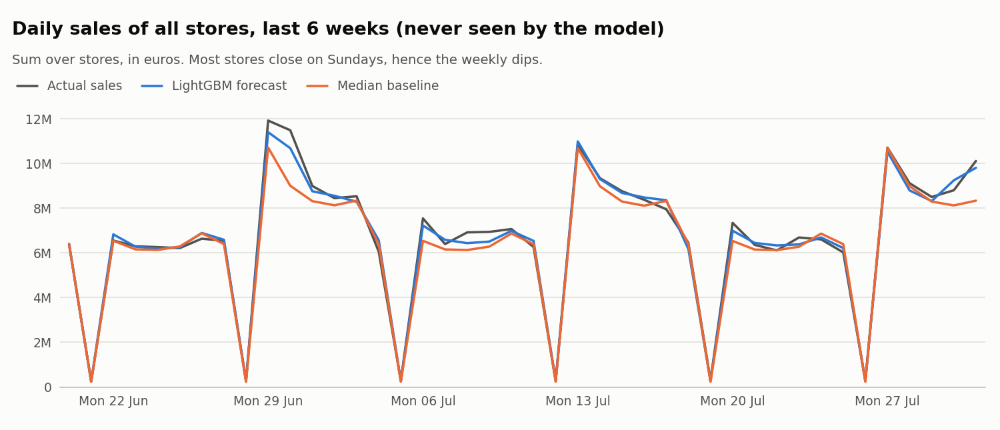

# Rossmann Sales Forecasting

Shops plan their promotions weeks in advance, so they need to know two things: how much each store will sell, and how much a promotion really adds. This project answers both, using 2.5 years of daily sales from 1,115 Rossmann stores ([Kaggle data](https://www.kaggle.com/competitions/rossmann-store-sales/data)).

## How it works

1. **Prepare the data** with PySpark: clean it and add useful information, like the day of the week, holidays, promotions, nearby competitors and each store's past sales.
2. **Forecast** the sales of every store for the next 6 weeks with a LightGBM model.
3. **Measure the promotions**: the model forecasts each day twice, with and without a promotion. The difference shows how much the promotion adds.

## Results

<!-- results:start -->
- The forecast's error is about **25% lower** than a simple baseline's (0.109 vs 0.145 RMSPE).
- Promotions raise sales by about **34%** on promotion days.

<!-- results:end -->

**Tools:** Python, PySpark, LightGBM, pandas, Matplotlib

To run it, put the Kaggle data in `data/raw/`, then run `pip install -r requirements.txt` and `python -m rossmann.pipeline`.
