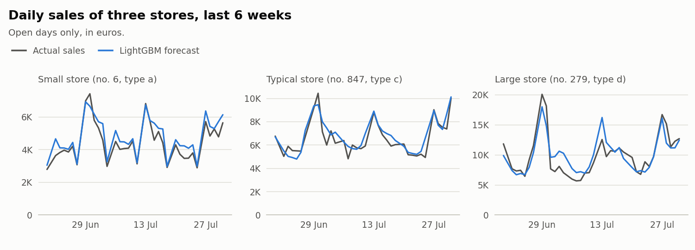
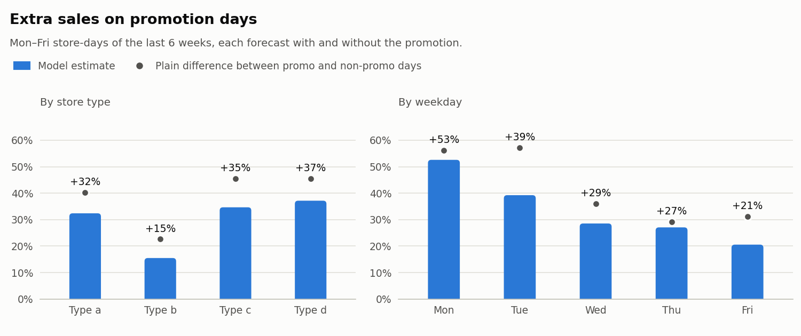
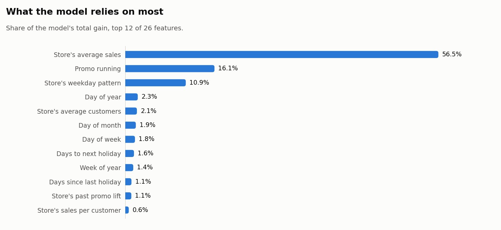

"""Write the results section of the README from the metrics, between two marker lines."""
from __future__ import annotations

import datetime as dt
import os
from pathlib import Path

START = "<!-- results:start -->
Measured on the test weeks, 20 June 2015 to 31 July 2015, which the model never saw during training (40,282 store-days, 1,115 stores):

| Forecast | RMSPE | MAPE |
|---|---|---|
| Median baseline: past median of the same store, weekday and promo status | 0.145 | 10.8% |
| **LightGBM** (this project) | **0.109** | **7.9%** |

RMSPE is the error measure of the Kaggle competition: the typical error in percent of the real sales. Lower is better. LightGBM cuts the baseline's error by 25%.

On a promotion day, a store sells about **34% more** than it would without the promotion, about €2,056 extra per store and day. The effect depends on the store: from +15% for type b stores to +37% for type d stores (Monday–Friday store-days of the test weeks).

<picture>
  <source media="(prefers-color-scheme: dark)" srcset="reports/figures/forecast_total-dark.png">
  
</picture>

<picture>
  <source media="(prefers-color-scheme: dark)" srcset="reports/figures/forecast_stores-dark.png">
  
</picture>

<picture>
  <source media="(prefers-color-scheme: dark)" srcset="reports/figures/promo_uplift-dark.png">
  
</picture>

| Store type | Store-days | Uplift (model) | Extra sales per store-day | Plain difference in the data |
|---|---|---|---|---|
| a | 18,017 | +32.4% | €1,990 | +40.2% |
| b | 510 | +15.5% | €1,530 | +22.6% |
| c | 4,440 | +34.7% | €2,033 | +45.4% |
| d | 10,440 | +37.2% | €2,205 | +45.6% |
| **all** | 33,407 | **+33.7%** | €2,056 | +42.0% |

<picture>
  <source media="(prefers-color-scheme: dark)" srcset="reports/figures/feature_importance-dark.png">
  
</picture>

Data: 1,017,209 rows, 1,115 stores, 1 January 2013 to 31 July 2015; 180 stores have missing days. Full run: 4 minutes. All the numbers are in [`metrics.json`](reports/metrics.json).
<!-- results:end -->"

_CHARTS = [
    ("forecast_total", "Daily sales of all stores over the test weeks: actual sales, LightGBM forecast and median baseline"),
    ("promo_uplift", "Extra sales on promotion days, by store type and by weekday"),
]

def _day(iso: str) -> str:
    d = dt.date.fromisoformat(iso)
    return f"{d.day} {d:%B %Y}"

def _picture(folder: str, name: str, alt: str) -> str:
    return (f'<picture>\n  <source media="(prefers-color-scheme: dark)" srcset="{folder}/{name}-dark.png">\n'
            f'  \n</picture>')

def results_markdown(metrics: dict, reports_folder: str = "reports") -> str:
    acc, up, split = metrics["accuracy_on_test_weeks"], metrics["promo_uplift"], metrics["split"]
    first, last = split["test_period"].split(" to ")
    base, lgb = acc["median_baseline"], acc["lightgbm"]
    by_type = sorted(up["by_store_type"], key=lambda r: r["model_uplift_pct"])
    overall = up["overall"]
    figures = f"{reports_folder}/figures"
    return "\n".join([
        f"Last 6 weeks ({_day(first)} to {_day(last)}), never seen by the model:",
        "",
        "| Forecast | RMSPE | MAPE |",
        "|---|---|---|",
        f"| Median baseline | {base['rmspe']:.3f} | {100 * base['mape']:.1f}% |",
        f"| **LightGBM** | **{lgb['rmspe']:.3f}** | **{100 * lgb['mape']:.1f}%** |",
        "",
        f"On promotion days, stores sell about **{overall['model_uplift_pct']:.0f}% more** "
        f"(€{overall['extra_sales_per_store_day']:,.0f} per store and day), from "
        f"+{by_type[0]['model_uplift_pct']:.0f}% for type {by_type[0]['StoreType']} stores to "
        f"+{by_type[-1]['model_uplift_pct']:.0f}% for type {by_type[-1]['StoreType']} stores.",
        "",
        _picture(figures, *_CHARTS[0]),
        "",
        _picture(figures, *_CHARTS[1]),
        "",
        f"More charts in [`{reports_folder}/figures`]({figures}), all numbers in "
        f"[`metrics.json`]({reports_folder}/metrics.json).",
    ])

def update_readme(metrics: dict, readme: str | Path, reports_dir: str | Path) -> bool:
    """Replace the text between the markers. Returns False if the README has no markers."""
    readme = Path(readme)
    text = readme.read_text(encoding="utf-8")
    if START not in text or END not in text:
        return False
    reports_folder = Path(os.path.relpath(Path(reports_dir), readme.parent)).as_posix()
    before, rest = text.split(START, 1)
    _, after = rest.split(END, 1)
    readme.write_text(f"{before}{START}\n{results_markdown(metrics, reports_folder)}\n{END}{after}", encoding="utf-8")
    return True